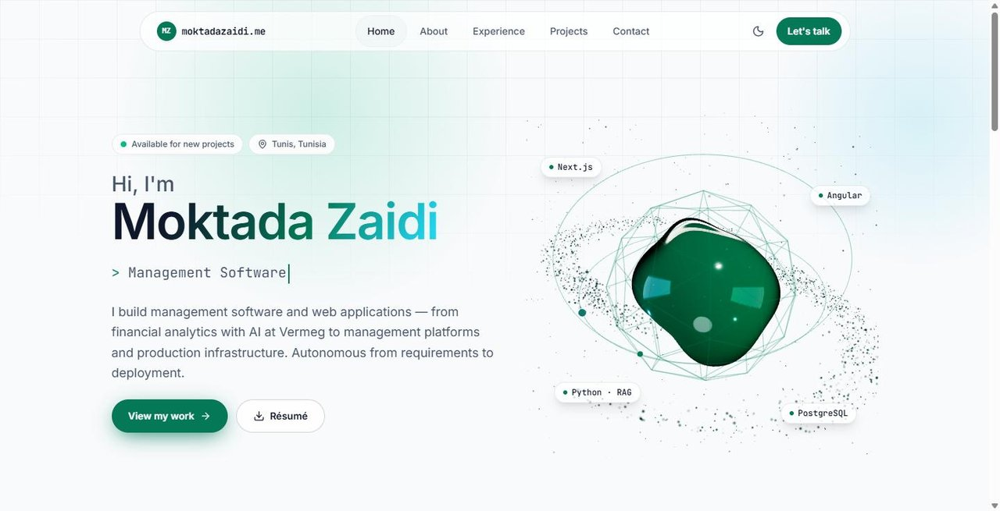
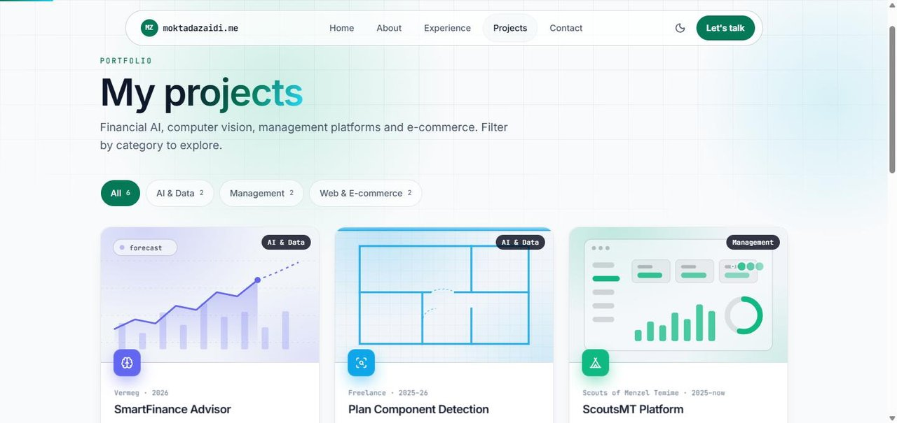

# moktadazaidi.me — Developer Portfolio


**Live:** [www.moktadazaidi.me](https://www.moktadazaidi.me)

My personal site: who I am, where I've worked, what I've built, and how to reach me.





## What's inside

- **Home, About, Experience, Projects, Contact** pages using the App Router
- **Experience timeline** and **project grid** with generated cover visuals
- Motion design with the `motion` library: page transitions, a loading screen, scroll progress and an ambient background
- All content (profile, experience, projects, links) lives in one typed file, [`src/lib/data.ts`](src/lib/data.ts), so updating the site means editing data, not components
- SEO metadata with a canonical base URL

## Run locally

```bash
npm install
npm run dev     # http://localhost:3000
```

## Author

**Moktada Zaidi** — [LinkedIn](https://www.linkedin.com/in/moktada-zaidi-677b94313/) · [GitHub](https://github.com/mo9tada)
